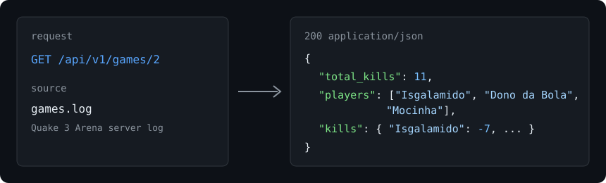
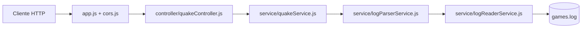

<div align="center">

# Quake Log Parser API

**API REST em Node.js que lê o log de um servidor de Quake 3 Arena e devolve, por partida, o total de kills, os jogadores e o placar de cada um.**<br/>
Um `GET /api/v1/games` transforma o `games.log` em JSON pronto para consumir.


<br/>



</div>

Uma API REST desenvolvida em Node.js para ler e interpretar logs de partidas de Quake 3 Arena, retornando um agrupamento de dados organizados com estatísticas dos jogadores.

## 📑 Tabela de Conteúdos

- [Por que Node?](#-por-que-node)
- [Como funciona](#-como-funciona)
- [Requisitos](#-requisitos)
- [Instalação](#-instalação)
- [Como usar (API)](#-como-usar-api)
- [Configuração](#-configuração)
- [Testes](#-testes)
- [Limitações conhecidas](#-limitações-conhecidas)
- [Licença](#-licença)

## 💡 Por que Node?
Pela simplicidade, natureza assíncrona e rapidez que o ecossistema Node.js proporciona para leitura de arquivos e criação de serviços web.

## 🧭 Como funciona



- `logReaderService` lê o `games.log` e separa em linhas.
- `logParserService` abre uma partida a cada `InitGame`, registra jogadores em `ClientUserinfoChanged` e conta cada linha `killed`.
- `quakeService` expõe a lista completa e a busca por partida (404 quando não existe).
- O arquivo é relido e interpretado a cada requisição.

## ⚙️ Requisitos

Antes de começar, certifique-se de ter as seguintes ferramentas instaladas:
- [Node.js](https://nodejs.org/en/) (Recomendado versão LTS)
- [Yarn](https://yarnpkg.com/pt-BR/) (Opcional, você pode usar o npm)

> [!WARNING]
> Com as dependências travadas no repositório (`express-load@1.1.15`), `node app.js` e `npm test` falham no carregamento com `TypeError: require.extensions.hasOwnProperty is not a function` no Node 20, 22 e 24 (e também no 12 e 14). Veja [Limitações conhecidas](#-limitações-conhecidas).

## 🚀 Instalação

1. Clone este repositório para a sua máquina.
2. Acesse a pasta do projeto via terminal.
3. Instale as dependências executando um dos comandos abaixo:

```bash
npm install
# ou
yarn install
```

## 🌐 Como usar (API)

Para iniciar o servidor, execute o seguinte comando:

```bash
node app.js
```

A aplicação será iniciada e estará disponível no seguinte endereço:
`http://localhost:4500/`

> **Observação:** Esta será a configuração padrão caso as variáveis de ambiente `process.env.URL`, `process.env.PORT` e `process.env.VERSION` não estejam definidas.

### Endpoints Disponíveis

Você pode utilizar ferramentas como **Postman**, **Insomnia** ou **cURL** para consumir os endpoints.

| Método | Rota | Resposta |
|---|---|---|
| GET | `/api/v1/games` | `200` com um objeto `game_1` ... `game_N` (21 partidas no `games.log` incluído) |
| GET | `/api/v1/games/:game` | `200` com a partida `game_<n>`; `404` se não existir |

**1. Listar todas as partidas:**
```bash
curl -X GET -H "Cache-Control: no-cache" "http://localhost:4500/api/v1/games"
```

**2. Listar dados de uma partida específica (ex: partida 1):**
```bash
curl -X GET -H "Cache-Control: no-cache" "http://localhost:4500/api/v1/games/1"
```

Exemplo de resposta para `/api/v1/games/2`:

```json
{"total_kills":11,"players":["Isgalamido","Dono da Bola","Mocinha"],"kills":{"Isgalamido":-7,"Dono da Bola":0,"Mocinha":0}}
```

Partida inexistente (`/api/v1/games/999`):

```json
{"erro":"Esse game não foi encontrado em nosso log.","statusCode":404}
```

Regras de contagem: cada linha `killed` soma em `total_kills`; morte causada por `<world>` subtrai 1 do jogador morto; suicídio (matador igual ao morto) não pontua.

## 🔧 Configuração

| Variável | Propósito | Obrigatória / padrão | Exemplo |
|---|---|---|---|
| `URL` | Host exibido no log de inicialização | não / `http://localhost` | `http://0.0.0.0` |
| `PORT` | Porta HTTP da API | não / `4500` | `8080` |
| `VERSION` | Número usado no prefixo da rota (`/api/v<VERSION>`) | não / `1` | `2` |

O arquivo lido é sempre `./games.log`, relativo ao diretório de onde o processo é iniciado.

## 🧪 Testes

O projeto utiliza o **Mocha** para a execução de testes unitários.

Para rodar os testes, certifique-se de que o Mocha está instalado (pode ser globalmente ou via dependências do projeto) e execute o comando:

```bash
npm test
```

## ⚠️ Limitações conhecidas

- O carregamento dos controllers depende do `express-load@1.1.15`, que chama `require.extensions.hasOwnProperty(...)`. Em versões atuais do Node `require.extensions` não tem protótipo, então o app não sobe. Rodando a mesma suíte com um shim externo (`Object.setPrototypeOf(require.extensions, Object.prototype)` via `node -r`) os 7 testes passam, o que indica que a lógica de parsing está correta e o problema é só o carregador.
- O mocha não encerra o processo sozinho depois dos testes, porque `app.js` chama `app.listen`; use `--exit` se o comando travar.
- O parsing relê o `games.log` inteiro a cada requisição, sem cache nem paginação.
- Só os eventos `InitGame`, `ClientUserinfoChanged` e `killed` são interpretados; os demais eventos do log são ignorados.
- O CORS libera qualquer origem (`*`) apenas para `GET`.

## 📄 Licença

ISC, conforme declarado em `package.json`. O repositório não possui arquivo `LICENSE`.
